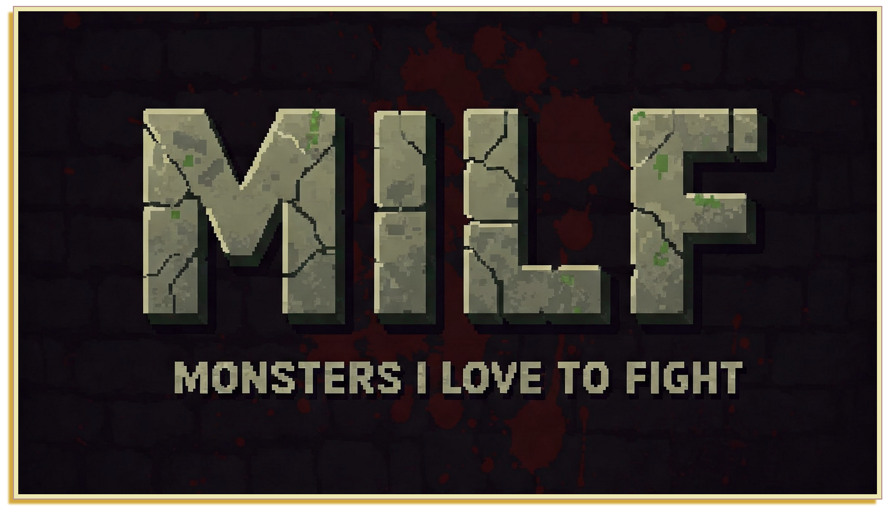
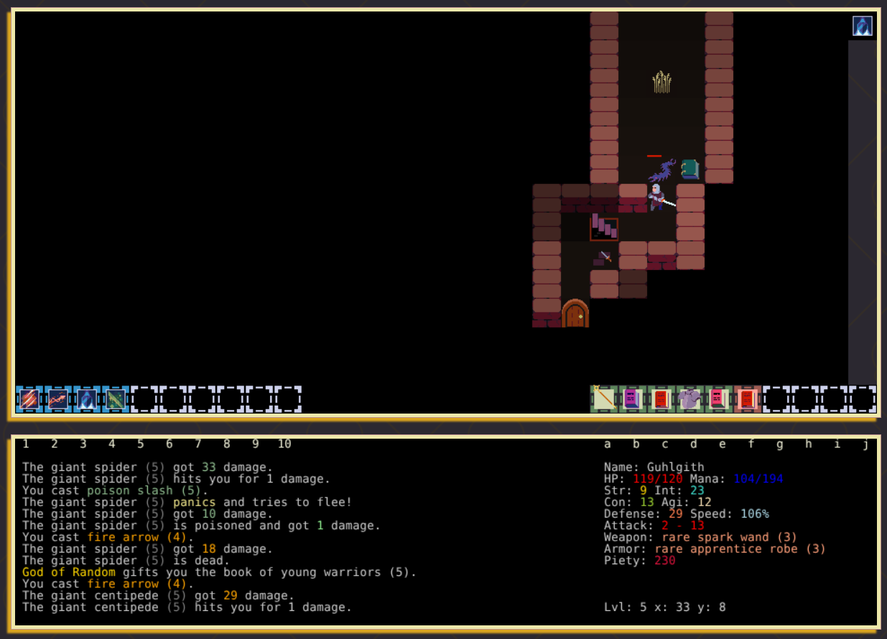

# MILF: Monsters I Love to Fight

  

  <b>A classic tile-based fantasy roguelike built with JavaScript and <a href="https://ondras.github.io/rot.js/hp/">rot.js</a>.</b> 
  <a href="https://ganochenkodg.github.io/milf/"><b>▶️ Play Online</b></a> · <a href="skills.md"><b>📖 Skills Reference</b></a>

---

## Overview

Descend through 50+ procedurally generated dungeon floors teeming with scaling monsters, rare loot, and arcane magic. Worship the **God of Random** by sacrificing gear for divine gifts, hunt down mutated **Fleshlords** every 10th floor, and consume their hearts to mutate your body or open the portal out of the infinite dungeon.

### Features
- **3 Difficulty Modes**: *Easy*, *Normal*, and *Hard* with tailored stat modifiers, healing multipliers, and rare spawn rates.
- **70+ Weapons, Armors, Potions & Tomes**: Swords, staves, elemental weapons, armor sets, and spellbooks that automatically grant the highest-level version of equipped skills.
- **34 Skills & Chants**: Ranged spells, melee weapon arts, elemental shields, status effects (*poison*, *stun*, *confuse*, *freeze*), healing, and teleportation.
- **Tactical Monster AI**: Enemies patrol the dungeon, open doors, avoid friendly fire, remember your last known position, and panic when critically wounded.

---

## Controls

| Key | Action |
| :--- | :--- |
| **Arrows / Numpad** | Move / Attack / Aim skill |
| **Enter** | Pick up item / Use stairs / Confirm target |
| **1 .. 0** | Select skill (slots 1–10) |
| **a .. j** | Inspect inventory item (`e` use/equip, `d` drop, `s` sacrifice) |
| **w** | Pray to the God of Random (spend Piety) |
| **z** | Auto-rest (stops on enemy sight, damage, or any key) |
| **Numpad 5** | Wait one turn |
| **Esc** | Cancel menu / skill targeting |

  

---

## Changelog

- **11.2026 — v1.3**: Enhanced gameplay mechanics and optimized in-game events.
- **11.2026 — v1.2**: Complete codebase refactoring, major bug fixes, improved game balance, and smarter monster AI.
- **11.2025 — v1.1**: Code refactoring and various bug fixes.
- **02.2025 — v1.0**: First playable version.

---

## Credits

- Built with [rot.js](https://ondras.github.io/rot.js/hp/) roguelike toolkit.
- Sprites from the [32rogues](https://sethbb.itch.io/32rogues) tileset.
